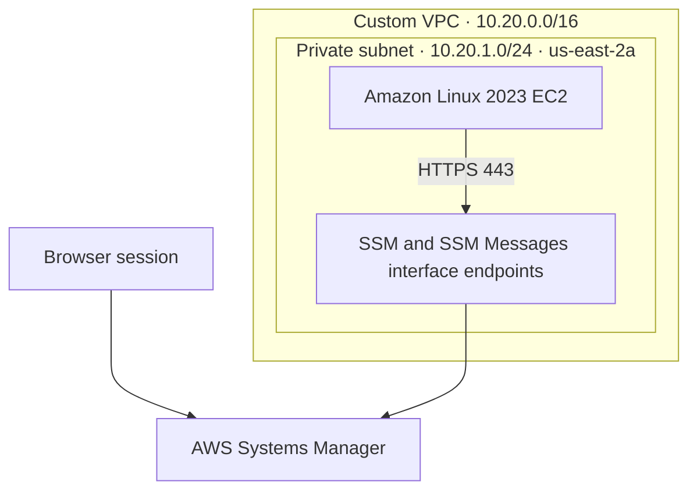

# Private EC2 Access with AWS Systems Manager

I built and tested a private Amazon Linux 2023 EC2 instance in AWS US East (Ohio).
I connected to it through AWS Systems Manager Session Manager without a public IP
address, an SSH key pair, or inbound security group rules.

## Architecture

## What I configured

- **Networking:** A custom VPC and private subnet with no direct route to an internet gateway. I enabled DNS resolution and DNS hostnames to support private endpoint DNS.
- **IAM:** An EC2 instance role with the `AmazonSSMManagedInstanceCore` policy so the Systems Manager agent could register and establish a session.
- **Private connectivity:** Two interface endpoints, `ssm` and `ssmmessages`. Their security group accepted HTTPS on TCP 443 from the private subnet.
- **EC2:** A `t3.micro` instance with public IP assignment disabled and zero inbound security group rules.

## Verification

I opened a browser shell through Session Manager and verified the session user and private IP.

| Command | Observed output |
|---|---|
| `whoami` | `ssm-user` |
| `hostname -I` | `10.20.1.252` |

